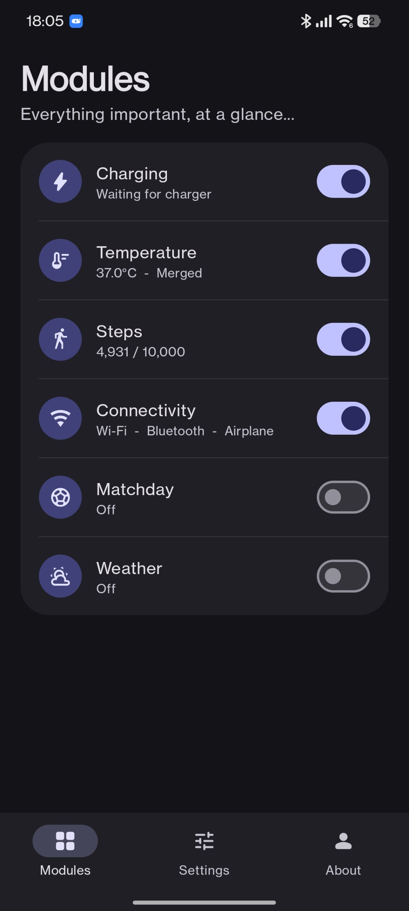
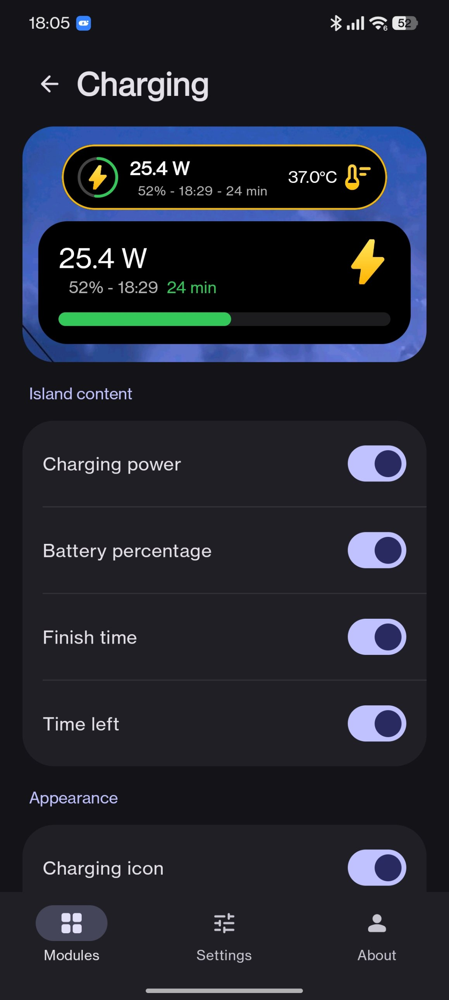
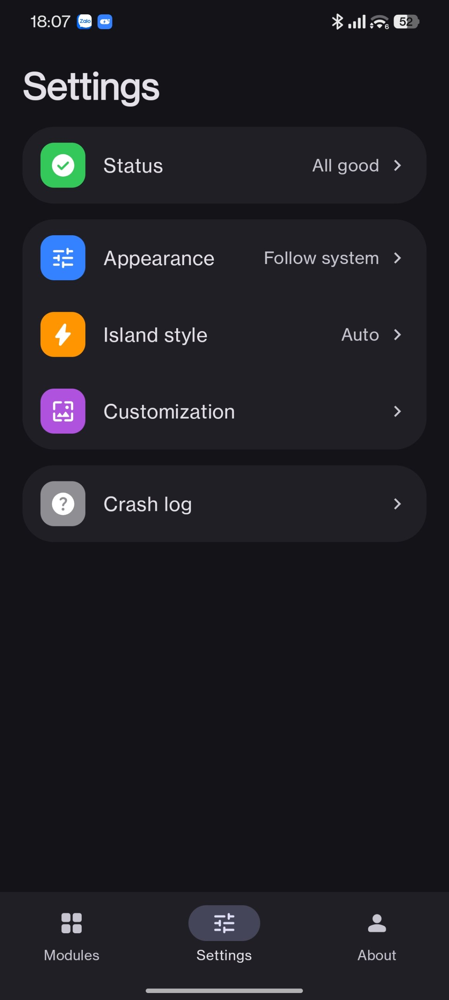
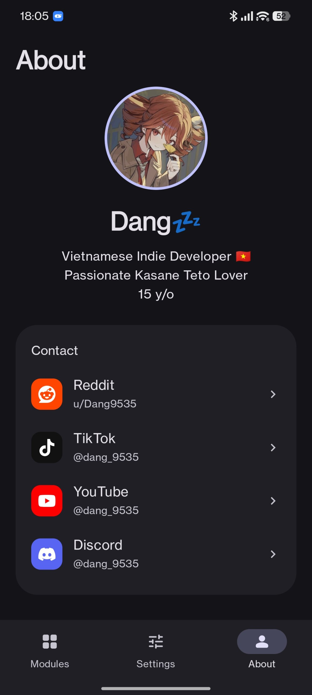
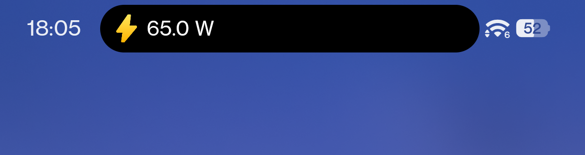
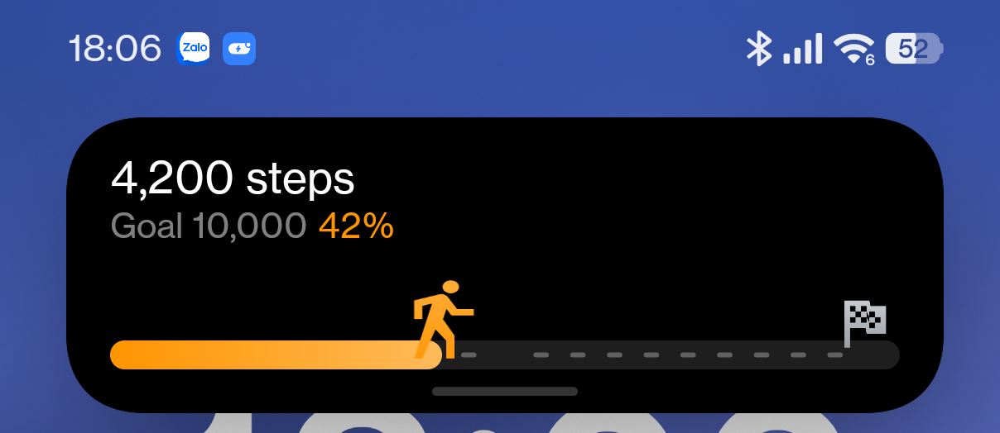
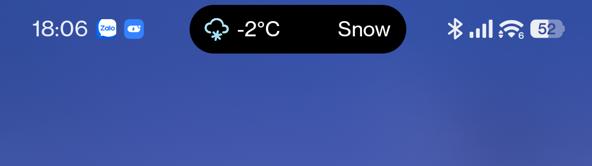
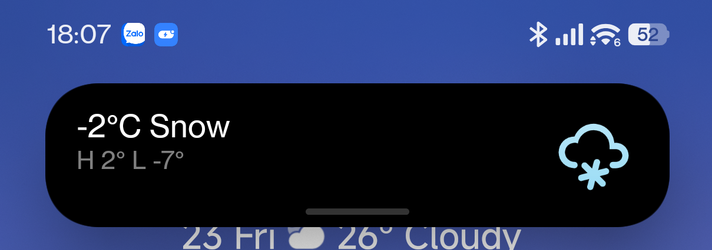

<p align="center">
  
</p>

<h1 align="center">GlanceCaps</h1>
<p align="center"><em>Everything important, at a glance.</em></p>

<p align="center">
  
  
  
  
</p>

## What it's for

GlanceCaps puts useful stuff in the island at the top of your screen. Charging speed, battery temperature, steps, Wi-Fi and Bluetooth changes, live match scores, weather, and weather alerts all show up there, so you don't have to open an app to check them.

It's built for Xiaomi phones on HyperOS 3, where it uses the native island. On other Android phones it falls back to Live Update notifications, which look plainer but do the same job.

## Modules

| Module | What it does |
|---|---|
| Charging | Shows watts, percentage and time left while charging |
| Temperature | Battery temperature, can merge into the charging island |
| Steps | Step count, goal progress, and an optional goal pop |
| Connectivity | Wi-Fi, Bluetooth and airplane mode changes |
| Matchday | Live scores for a match you pick, from a short list of leagues |
| Weather | Current conditions and temperature from a source you choose |
| Weather alerts | Cyclones, floods, earthquakes and official warnings near your city |

## Screenshots

<p align="center">
  
  
  
  
</p>

<p align="center">
  
  
</p>

<p align="center">
  
  
</p>

## Installation and setup

1. Go to the [Releases](../../releases) page and download the APK.
2. Install it. If your phone asks, allow installs from your browser or file manager.
3. Open GlanceCaps, then go to **Settings → Status**. It shows what still needs permission.
4. On Xiaomi phones, allow the island permission and turn on autostart. Without autostart, HyperOS kills the service in the background.
5. Turn on the modules you want from the **Modules** tab. Some ask for permissions the first time, like activity recognition for steps or location for weather.

There are two builds. **GlanceCaps** is the normal one. **GlanceCaps Miuix** has the MiuiX look and blur options. They have different package names, so you can have both installed.

## Requirements

| | Android version | Phone |
|---|---|---|
| Minimum | Android 10 (API 29) | Any Android phone. Uses Live Update notifications. |
| Recommended | HyperOS 3 or newer | Xiaomi, Redmi or POCO for the full island |

Tested and supported systems:

| System | Status |
|---|---|
| HyperOS 3+ | Recommended, the main target |
| ColorOS 16 | Officially Tested |
| OneUI 8 | Supported |
| PixelUI 16 | Supported |

## API keys

Most sources work without a key. A few don't:

- **AccuWeather, OpenWeatherMap, WeatherAPI.com**: paste your own key in the field under the weather source picker.
- **API-Football** (Matchday): paste your own free key from api-football.com.

Keys are saved on your phone only. They're never sent anywhere except to the service they belong to.

## Build from source

The whole project is here, so you can check exactly what the app does before you install it.

```
git clone https://github.com/ZTHDang9535/GlanceCaps.git
cd GlanceCaps
./gradlew assembleNormalDebug
```

For the MiuiX build, run `./gradlew assembleMiuixDebug`. You need JDK 17 and the Android SDK. The APKs end up in `app/build/outputs/apk/`. CI builds both on every push, so you can also grab the artifacts from the Actions tab.

## Limitations

- **Island padding on HyperOS**: Auto Island Padding is an estimate, and the island can still look a bit off on some layouts. Turning it off gives you a length slider to fix it by hand.
- **Some sources might not work**: free data sources change or go down without warning. If a weather or match source shows nothing, try another one from the dropdown.
- **Matchday coverage** varies by league and source. API-Football is the most complete.
- **Weather alerts** use global feeds, so local warnings from some countries may not show up.

## Credits

**Icons**
- [Material Symbols](https://github.com/google/material-design-icons) by Google, Apache 2.0
- [Material Design Icons](https://github.com/Templarian/MaterialDesign) by Pictogrammers, Apache 2.0
- [Simple Icons](https://simpleicons.org) for the Reddit, TikTok, YouTube and Discord logos, CC0

**UI and effects**
- [Haze](https://github.com/chrisbanes/haze) by Chris Banes, Apache 2.0, for the blur
- [Jetpack Compose](https://developer.android.com/jetpack/compose), Material 3 and AndroidX, Apache 2.0
- [kotlinx.coroutines](https://github.com/Kotlin/kotlinx.coroutines), Apache 2.0
- [Health Connect client](https://developer.android.com/health-and-fitness/health-connect), Apache 2.0

**Data sources**
- [Open-Meteo](https://open-meteo.com), [MET Norway](https://api.met.no), [wttr.in](https://wttr.in)
- [GDACS](https://www.gdacs.org), [USGS Earthquake Hazards](https://earthquake.usgs.gov), [US National Weather Service](https://www.weather.gov)
- [API-Football](https://www.api-football.com), [TheSportsDB](https://www.thesportsdb.com), [ESPN](https://www.espn.com) and [SofaScore](https://www.sofascore.com) endpoints for match data

**Reference**
- [HyperIsland-ToolKit](https://github.com/D4vidDf/HyperIsland-ToolKit) by D4vidDf, Apache 2.0, used as a reference for the island format. No code is copied.

Full notices are in [THIRD_PARTY_NOTICES.md](THIRD_PARTY_NOTICES.md).

**Special thanks** to everyone who tested early builds and reported what broke. You found the bugs I couldn't see from here.

## Support

If GlanceCaps is useful to you and you want to buy me a coffee, you can send a donation through MoMo or a Vietnamese bank with the QR codes below. Totally optional, and thank you either way.

<p align="center">
  
  
</p>
